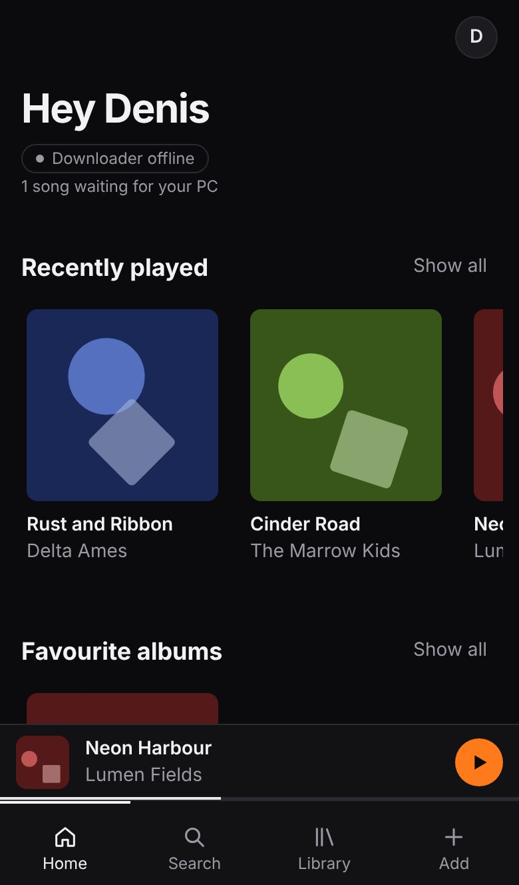
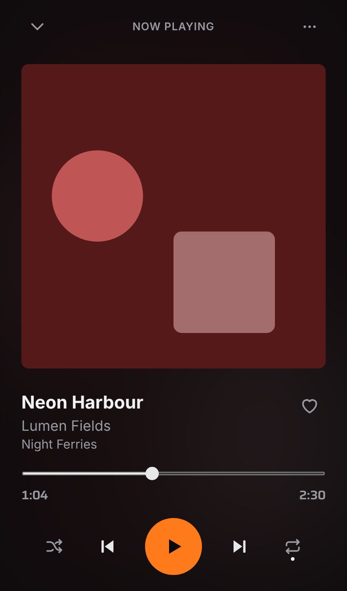
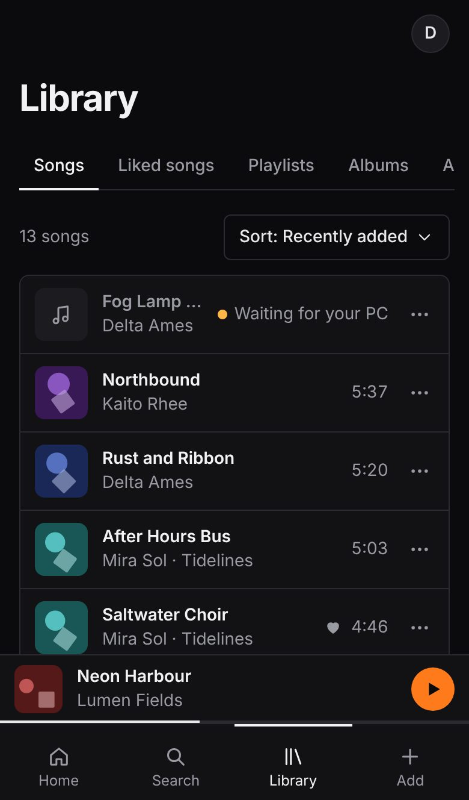
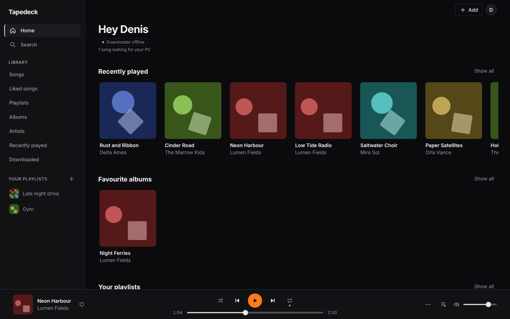

# Tapedeck: handoff

## What was built

Tapedeck is your own music app. Paste a YouTube or SoundCloud link (or search YouTube in the app), and the song lands in your library as "Waiting".
A small program on your Windows PC downloads it, cleans up the title, artist and cover, and uploads it to your storage.
It plays on your iPhone (installed to the home screen, keeps playing when locked) and in Chrome on your PC.
You get playlists, liked songs, favourite albums, a full player with queue, shuffle and repeat, offline downloads for flights, and "Save to Files".
Optional: new songs also go into Apple Music on your PC.

**Live app:** not deployed yet. You make it live in step 0 below (about 20 minutes); the address will look like `https://tapedeck-xxxx.vercel.app`.

## Tickets

Every check runs on GitHub for every change (desktop Chrome, Android Chrome and an iPhone stand-in). "e2e runs" counts each check once per device it runs on.

| Ticket | What | Status | Checks |
|---|---|---|---|
| T0 | Scaffold, password, setup page, keepalive, test tones | Done | 9 e2e runs, plus unit tests |
| T1 | Paste a link, PC downloads it, it plays | Done | 3 e2e runs, plus unit and downloader tests |
| T2 | Library, playlists, albums, full player | Done | 21 e2e runs, 31 queue unit tests |
| T3 | Title cleanup, covers, edit, YouTube search, SoundCloud | Done | 15 e2e runs, 23 cleaner fixtures |
| T4 | Offline on the phone, Save to Files | Done | 9 e2e runs |
| T5 | Design polish and review | Done | 6 e2e runs, Lighthouse accessibility 100 and 100 |
| T6 | Apple Music export | Done | 3 e2e runs, downloader tests |
| T7 | README and repo check | Done | `scripts/check-repo.sh` passes |
| T8 | This handoff | Done | |

All of it: about 680 app unit tests, 133 downloader tests and 66 e2e runs, all passing. Details per ticket: [TEST-REPORT.md](TEST-REPORT.md).

## Screenshots (made-up songs)

| Home (phone) | Now playing (phone) | Library (phone) |
|---|---|---|
|  |  |  |

Every screen at both sizes: [screenshots/](screenshots/), reviewed in [UI-REVIEW.md](UI-REVIEW.md).

## Your steps

### 0. Go live (about 20 minutes)

1. **Supabase.** supabase.com > sign in with GitHub > "New project", name `tapedeck`, choose a database password (save it), region "East US", Create, wait about 2 minutes. Click "Connect" at the top > "Transaction pooler" > copy the URI and put your database password where it says `[YOUR-PASSWORD]`. This is `DATABASE_URL`.
2. **Cloudflare R2.** dash.cloudflare.com > sign up > R2 Object Storage. It asks for a card: add it (it stays free under 10 GB). "Create bucket", name `tapedeck-audio`. Back on the R2 page: "Manage API tokens" > "Create API token" > permission **Admin Read & Write** > Create. Copy Access Key ID (`R2_ACCESS_KEY_ID`), Secret Access Key (`R2_SECRET_ACCESS_KEY`) and the Account ID on the R2 page (`R2_ACCOUNT_ID`).
3. **YouTube key (optional, turns on search).** console.cloud.google.com > "Select a project" > "New project" `tapedeck` > search "YouTube Data API v3" > Enable > "Credentials" > "Create credentials" > "API key". This is `YOUTUBE_API_KEY`.
4. **Anthropic key (optional, smarter title cleanup).** console.anthropic.com > API Keys > Create key. This is `ANTHROPIC_API_KEY`.
5. **Vercel.** vercel.com > "Add New" > Project > import `dennycrafter/tapedeck` > Root Directory `web` > Deploy. Then Settings > Environment Variables: add `DATABASE_URL`, the three R2 values, `R2_BUCKET` = `tapedeck-audio`, the optional keys, and `APP_PASSWORD` (your own password, 12 or more characters). Open the app: the Setup page shows three generated secrets with Copy buttons; add them as `SESSION_SECRET`, `AGENT_TOKEN`, `CRON_SECRET`. Deployments > "..." > Redeploy.
6. Open the app again, type your password on the Setup page and press "Finish setup". It creates the database tables and the storage settings by itself, then takes you to the login screen.

After "Finish setup" works, ask Claude to run `npm run e2e:live` to test the real services.

### 1. On your PC

Download the repo (green "Code" button > Download ZIP), unzip it to `Documents\tapedeck`, and double-click `agent\install.bat`. Then open the app > Profile > "Downloader setup" and copy the two values (`APP_URL` and `AGENT_TOKEN`) into the Notepad window it opens. Save and close Notepad.

### 2. On your iPhone

Open the app's address in Safari > Share > Add to Home Screen > open it from the home screen and log in.

### 3. On your iPhone, check

1. Open `/test-audio` (add it to the app's address), press Play, and lock the phone. It should keep playing, the second tone should start by itself, and the lock screen should show the title.
2. Add one real song, wait for it to show as ready (no "Waiting" dot), and play it with the phone locked.
3. Download it (song menu > Download), turn on airplane mode, open the app from the home screen and play it again.
4. Song menu > Save to Files: the share sheet should open; pick "Save to Files".

## If a step fails

- **Songs stuck on "Waiting for your PC":** is the PC on and logged in? Check `agent\logs\downloader.log`.
- **Downloads failing after they worked before:** YouTube changed something. Restart the PC so the downloader updates yt-dlp.
- **"Search limit reached":** that is YouTube's free daily limit. Paste links instead until tomorrow.
- **Library gone:** the free Supabase project pauses after a week without use. Open Supabase and restore it.
- **Audio stops when the phone is locked:** open the app from the home screen icon, not from Safari.

## Decisions made without you

The full list with reasons is in [DECISIONS.md](DECISIONS.md). The ones you might notice:

- **Search tab:** it searches your own library as you type; YouTube search sits below it and only runs when you press Search (it has a daily limit).
- **Offline songs:** they play from your phone's storage through the app's offline helper, which is more reliable on iPhone than the method the plan first named.
- **Downloader:** it puts each song's index at the start of the file, so offline songs start playing right away.
- **AI title cleanup:** it is trusted when it is at least 50% sure, even for things that aren't music; those just get no cover.
- **"Restore original":** it only removes " - Topic" and "VEVO" from the artist.
- **"Edit details":** it is in each song's "..." menu.
- **Apple Music:** "Add to Apple Music" sends a ready song back to your PC once so it can copy it in.
- **Repo:** it has no long dashes anywhere except the build plan (SPEC.md).

## Needs you

1. **The live checks.** They test the real Supabase, R2 and Vercel, so they can only run after step 0. Ask Claude to run `npm run e2e:live`.
2. **The real iPhone checks** in step 3: the lock screen and background audio can't be tested on a computer.
3. **One Deezer cover.** Covers from Deezer now ask for the 600x600 size. After going live, add a song whose cover comes from Deezer and check it shows.
4. **Optional cleanup.** On GitHub, delete the branch `debug-webkit-blob` (a closed experiment; the build machine is not allowed to delete branches).

**Known gap, not blocking:** two T0 checks on the `/test-audio` page (tone 1 rolls into tone 2 on the iPhone stand-in, and the page's own offline copy) were never automated by the original build. The same things are checked on the real app by T2 (next song starts by itself, lock screen title) and T4 (offline reload and playback), and step 3 above covers them on your phone.
